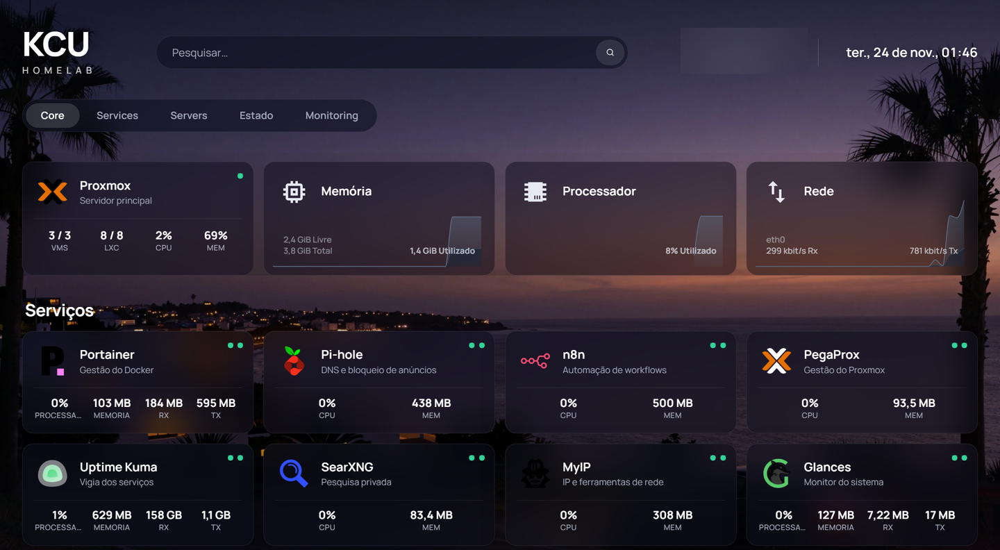
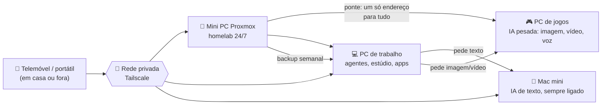

# KCU Stack 🧱

**O nosso setup completo, como ele está a funcionar hoje.** São quatro máquinas em casa, um servidor Proxmox com 11 serviços, IA local a correr sem nuvem e as apps que usamos todos os dias. Para cada peça dizemos *para que serve* e *porque escolhemos assim*.

> Isto não é um tutorial de "copia e cola". É um mapa: vê o que te faz sentido e adapta ao teu. Nos vídeos mostramos cada parte a ser usada, sem cortes.
>
> *Our full home setup: four machines, a Proxmox server, local AI and the apps we use every day, with the reasons behind each choice. (In Portuguese.)*

*A página inicial do homelab, onde tudo começa. Tapámos o widget do tempo, que diz onde vivemos.*

## Como tudo se liga

**A ideia central:** nada está aberto à internet. Tudo passa por uma rede privada (Tailscale), e um pequeno servidor no Proxmox faz de "porta de entrada" única para os serviços de casa. Do telemóvel, abrimos uma página inicial e chegamos a tudo.

## O que está aqui

| Parte | O que tem |
|---|---|
| [Máquinas](docs/maquinas.md) | As 4 máquinas, o hardware de cada uma e porque cada coisa corre onde corre. |
| [Proxmox](docs/proxmox.md) | Cada container e VM do servidor de casa, e o papel de cada um. |
| [IA local](docs/ia.md) | Os modelos que usamos, em que máquina, e as definições que funcionam bem em 8 GB e em 16 GB de VRAM. |
| [Apps do dia a dia](docs/apps.md) | Obsidian, Voice Studio, FreeBuff, a homepage, KCU Window, PIGGY + LifeOS… |
| [Automáticos](docs/automaticos.md) | O que corre sozinho: desligar à noite, limpar RAM, vigias, backups, relatórios. O código está no [kcu-automaticos](https://github.com/KCUServices/kcu-automaticos). |
| [Canal do Discord](docs/discord.md) | Onde os alertas, os backups e o agente nos avisam. |
| [Tema da homepage](tema-homepage) | O `custom.css` da nossa página inicial, pronto a usar. |
| [Fluxos do n8n](n8n) | Respostas automáticas a comentários: Instagram (comentário → DM com o link) e YouTube. |
| [Homelab](homelab) | Modelos prontos a adaptar: a [ponte Tailscale](homelab/ponte-tailscale) (um só endereço para todos os serviços de casa) e o [backup semanal do Proxmox](homelab/backup-proxmox) com aviso no Discord. |

## Princípios que seguimos

1. **Local primeiro.** Se dá para correr em casa, corre em casa. A nuvem fica para o que não cabe.
2. **Cada máquina com um papel.** A GPU grande faz imagem e vídeo, o Mac faz texto 24/7 a gastar pouco, e o Proxmox guarda os serviços que nunca podem desligar.
3. **Nada exposto.** Rede privada para entrar, sem portas abertas no router.
4. **Tudo se vigia sozinho.** Se algo cai, volta a arrancar e avisa no Discord.
5. **Os PCs dormem.** Desligam de madrugada quando ninguém os está a usar, e ligam sozinhos de manhã.

## O que fica de fora (de propósito)

- **Endereços, nomes de rede, portas e chaves.** Nenhum setup público deve ter isso, e o teu também não.
- **O hardening do servidor passo a passo.** Está no [Playbook de Proteção](https://whop.com/kcu-services/kcu-playbook-protecao/) e na [Checklist de Segurança](https://whop.com/kcu-services/kcu-checklist-seguranca-servidor/).
- **As listas do Pi-hole** que bloqueiam apostas e pornografia estão no [Pi-hole anti-apostas](https://whop.com/kcu-services/kcu-pihole-anti-apostas/).

Queres isto montado no teu sem perder fins de semana? Temos a [Assistência KCU](https://whop.com/kcu-services/kcu-assistencia/).

## Episódios

| Ep. | Vídeo | Estado do stack | O que mudou |
|---|---|---|---|
| 00 | *em breve* | [ep00](../../tree/ep00) | Primeira versão pública |

O que mudou em cada versão está no [CHANGELOG](CHANGELOG.md).

## FAQ

**Preciso de 4 máquinas?**
Não. Começa com uma. Um mini PC com Proxmox já te dá a homepage, o Pi-hole e as automações. Junta IA quando tiveres uma GPU.

**Porquê Tailscale e não abrir portas?**
Porque uma porta aberta é encontrada por bots em minutos. Com uma rede privada, só os teus aparelhos chegam aos serviços.

**Quanto gasta isto de luz?**
O mini PC e o Mac gastam pouco e estão sempre ligados. Os dois PCs grandes desligam de madrugada.

**Posso pedir para mostrarem uma parte em vídeo?**
Sim, é para isso que servem as [Discussions](https://github.com/orgs/KCUServices/discussions/categories/ideas).

## Licença

[PolyForm Noncommercial 1.0.0](LICENSE): podes usar e adaptar à vontade para uso pessoal. Para vender ou usar num negócio, fala connosco no Instagram [@kcu.services](https://www.instagram.com/kcu.services).

**Marca e imagens:** o nome KCU, os logótipos e as imagens dos produtos são da KCU Services, com todos os direitos reservados. A licença cobre só o código e a documentação. Ver [MARCA.md](MARCA.md).
