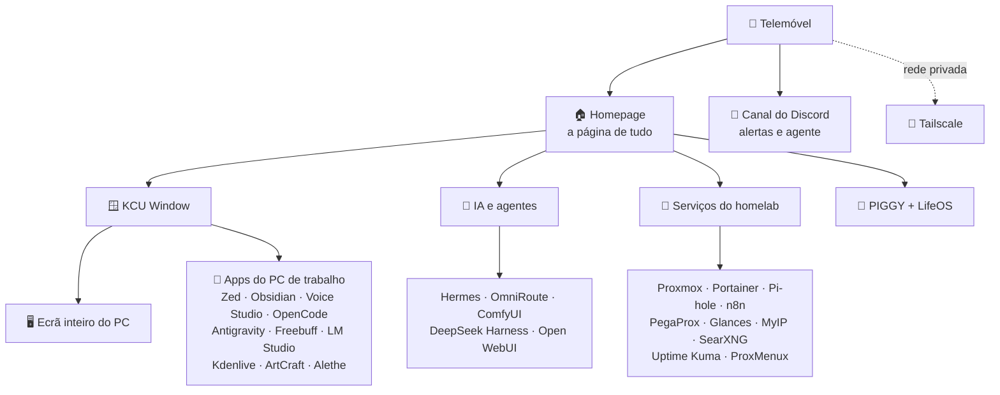

# Apps do dia a dia

Um dia normal começa no telemóvel: abrimos a página inicial e tudo está a um toque. Cada nome abaixo leva ao site oficial, para saberes o que é.

## Apps do PC de trabalho (abertas no telemóvel pelo KCU Window)

| App | Para que usamos |
|---|---|
| **[Zed](https://zed.dev)** | Editor de código rápido. |
| **[Obsidian](https://obsidian.md)** | Notas. |
| **[Voice Studio](https://github.com/debpalash/VoiceStudio)** | Vozes geradas e clonadas em casa (motor OmniVoice), sem ElevenLabs. |
| **[OpenCode](https://opencode.ai)** | Agente de programação no terminal e no browser. |
| **[Antigravity](https://antigravity.google)** | O editor com agentes da Google. |
| **[Freebuff](https://github.com/CodebuffAI/freebuff)** | Agente de código grátis (do Codebuff), na versão de secretária. |
| **[LM Studio](https://lmstudio.ai)** | Experimentar modelos de IA locais com uma janela simples. |
| **[Kdenlive](https://kdenlive.org)** | Edição de vídeo, aberta e grátis. |
| **[ArtCraft](https://github.com/storytold/artcraft)** | Criar imagens e vídeo com IA de forma visual. |
| **[Alethe](https://github.com/Kc1t/alethe-agents)** | Vários agentes de código ao mesmo tempo (Claude Code, Codex, Copilot e terminais) numa só app. |
| **Ecrã inteiro** | O monitor principal do PC todo, com som, quando precisamos de mais do que uma app. Está no [KCU Window](https://github.com/KCUServices/kcu-window) (`/?app=ecra`). |

## IA e agentes

| App | Para que usamos |
|---|---|
| **[Hermes Agent](https://github.com/NousResearch/hermes-agent)** | O "assistente da casa": crons, alertas, Discord e conversa. |
| **[OmniRoute](https://github.com/diegosouzapw/OmniRoute)** | Uma porta só (compatível com a OpenAI) para muitos modelos grátis, com troca automática quando um falha. |
| **[ComfyUI](https://github.com/comfyanonymous/ComfyUI)** | Imagem, vídeo, música e 3D com IA local. O nosso pipeline está no [kcu-ia-local](https://github.com/KCUServices/kcu-ia-local). |
| **[DeepSeek Harness](https://github.com/deepseek-ai/deepseek-harness)** | Agente de programação no browser, ligado a modelos locais ou ao OmniRoute. |
| **[Open WebUI](https://openwebui.com)** | O "ChatGPT de casa", ligado ao Ollama do Mac. |
| **[Ollama](https://ollama.com)** | O servidor de modelos de texto. A nossa configuração em português está no [kcu-ia-local](https://github.com/KCUServices/kcu-ia-local). |

## Serviços do homelab

| Serviço | Para que usamos |
|---|---|
| **[Proxmox VE](https://www.proxmox.com)** | O sistema do servidor de casa: containers e VMs. Ver [Proxmox](proxmox.md). |
| **[ProxMenux](https://github.com/MacRimi/ProxMenux)** | Menus para as tarefas comuns do Proxmox. |
| **[PegaProx](https://github.com/PegaProx/project-pegaprox)** | Painel extra para gerir o Proxmox. |
| **[Portainer](https://www.portainer.io)** | Gerir os containers Docker sem linha de comandos. |
| **[Pi-hole](https://pi-hole.net)** | DNS da casa toda e bloqueio de anúncios. |
| **[n8n](https://n8n.io)** | Automações. Os nossos fluxos estão em [n8n](../n8n). |
| **[Uptime Kuma](https://github.com/louislam/uptime-kuma)** | Vigia se os serviços estão de pé. |
| **[Glances](https://github.com/nicolargo/glances)** | Monitor do sistema: CPU, memória, discos e rede. |
| **[MyIP](https://github.com/jason5ng32/MyIP)** | Ferramentas de IP e de rede (o meu IP, DNS, velocidade). |
| **[SearXNG](https://github.com/searxng/searxng)** | Motor de pesquisa privado, sem rastreio. |
| **[Homepage](https://gethomepage.dev)** | A página inicial de tudo. O nosso tema está em [tema-homepage](../tema-homepage). |
| **[Umbrel](https://umbrel.com)** | Loja de apps de casa: Home Assistant, AFFiNE, AudioBookShelf e mais. |

## Acesso de fora de casa

| App | Para que usamos |
|---|---|
| **[Tailscale](https://tailscale.com)** | A rede privada: chegamos a tudo sem abrir portas no router. |
| **[KCU Window](https://github.com/KCUServices/kcu-window)** | Uma app do PC (ou o ecrã inteiro) no telemóvel. |
| **[Chrome Remote Desktop](https://remotedesktop.google.com)** | O PC todo, quando o KCU Window não chega. |

## O dia a dia

| App | Para que usamos |
|---|---|
| **[PIGGY + LifeOS](https://whop.com/kcu-services/kcu-piggy-lifeos/)** | As finanças e o "sistema de vida" em ficheiros markdown, sem dar dados a ninguém. |
| **KCU Estúdio** | O nosso estúdio de vídeo com IA. Ver a [montra](https://github.com/KCUServices/kcu-estudio). |
| **Canal do Discord** | Onde os alertas, os backups e o agente nos avisam. Ver [Discord](discord.md). |
| **[Syncthing](https://syncthing.net)** | Sincronizar ficheiros entre máquinas sem nuvem. |

## Definições que fazem diferença

- **Homepage:** os cartões apontam para a "porta de entrada" na rede privada, e as verificações de estado usam a rede de casa. Os links abrem fora de casa e o estado continua a funcionar.
- **KCU Window + apps feitas em Electron** (Obsidian, Voice Studio, Freebuff…): precisam de opções de arranque para não pararem de desenhar quando ficam tapadas. O KCU Window já trata disso.
- **Voice Studio:** o motor ocupa ~40 GB entre programa e cache. Põe-no num disco com espaço, não no do sistema. Confirma a licença do modelo de voz antes de usar num trabalho pago.
