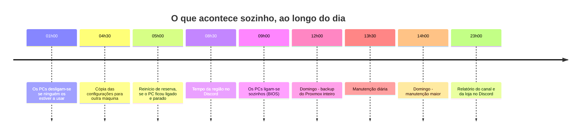
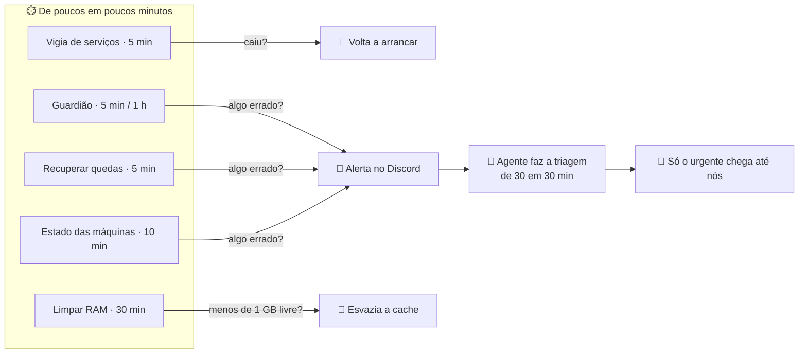

# Automáticos

O que corre sozinho. A regra: **se uma coisa se faz mais de duas vezes à mão, passa a ser automática e avisa quando falha.**

### Um dia na vida do setup

### O que está sempre a vigiar

## Energia

| O quê | Quando | Como |
|---|---|---|
| Desligar os PCs | 01:00, e volta a tentar de 15 em 15 min até às 03:00 | **Não** desliga se alguém estiver a usar o PC, se a GPU/CPU estiverem ocupadas, se um agente estiver a trabalhar ou se existir um ficheiro "não desligar". |
| Ligar os PCs | 09:00 | Pela própria BIOS (despertar por relógio). |
| Reinício de reserva | 05:00 | Só se o PC não desligou e está parado. |
| Acordar à distância | à mão | Wake-on-LAN a partir de outra máquina da casa. |

## Limpeza

| O quê | Quando |
|---|---|
| Limpar a RAM | de 30 em 30 min, **só** quando há menos de 1 GB livre (esvazia a "standby list") |
| Manutenção (temporários, etc.) | todos os dias às 13:30 |
| Manutenção maior | domingos às 14:00 |

## Vigias

| O quê | Quando | O que faz |
|---|---|---|
| Vigia de serviços | de 5 em 5 min | Volta a arrancar a voz, o ComfyUI, o Ollama e o Syncthing se caírem. Vigia também as outras máquinas. |
| Guardião | rápido de 5 em 5 min, completo de hora a hora | Saúde do PC de trabalho, com alertas no Discord. |
| Triagem de alertas | de 30 em 30 min | O agente lê os alertas e separa o urgente do ruído. |
| Recuperar quedas | de 5 em 5 min | Deteta cortes de luz e de rede e volta a pôr os crons a correr. |
| Estado das máquinas | de 10 em 10 min | Página com a saúde de tudo, e atualizações pendentes de 6 em 6 h. |
| Vigia do servidor | de 5 em 5 min | No Proxmox, junto com as atualizações de segurança automáticas. |

## Dados e relatórios

| O quê | Quando |
|---|---|
| Backup do Proxmox inteiro | domingos às 12:00, para outra máquina, guarda os 2 últimos e avisa no Discord se falhar |
| Cópia das configurações | todos os dias às 04:30, sincronizada para outra máquina |
| Relatório do canal e da loja | todos os dias às 23:00 no Discord |
| Tempo da região | todos os dias às 08:30 no Discord |
| Respostas a comentários (YouTube / Instagram) | n8n, de 10 em 10 min ou por webhook |

## Arranque

Quando o PC liga, tudo o que precisa de estar a correr arranca sozinho por **tarefas agendadas**: as apps que têm janela correm como *Interactive*, dentro da sessão do utilizador. Evitamos a "pasta de Arranque", onde as coisas ficam espalhadas.
