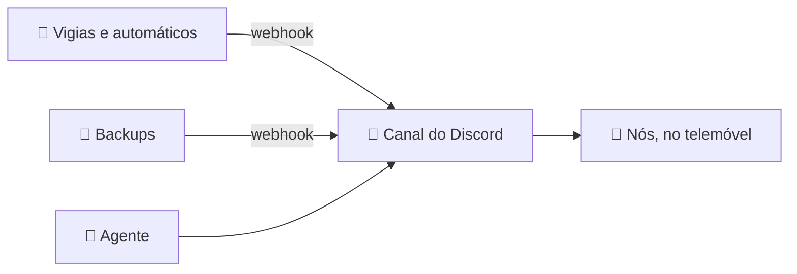

# Avisos num canal do Discord

As máquinas, os agentes e os automáticos avisam-nos num **canal do Discord**. Do telemóvel vemos o que importa sem abrir mais nenhuma app.



## Regras que aprendemos

- **Sucesso não faz barulho.** Um script que corre bem não publica nada (ou publica só o resultado). Mensagens de "correu tudo bem" a toda a hora escondem as que importam.
- **Só avisa o que precisa de atenção:** um serviço que caiu, um disco a encher, um backup que falhou, uma falta de luz.
- **Webhooks e tokens nunca no código.** Ficam numa variável de ambiente ou num ficheiro fora do repositório. Quem tem o endereço de um webhook pode escrever no teu canal.
- **Um webhook por origem.** Se um deles vazar, apagas só esse sem mexer nos outros.

## Como ligar

1. No teu canal: Definições do canal → Integrações → **Webhooks** → Novo webhook. Copia o endereço.
2. Guarda-o numa variável de ambiente e usa-o nos scripts. Os do [kcu-automaticos](https://github.com/KCUServices/kcu-automaticos) já leem `KCU_DISCORD_WEBHOOK`:

   ```powershell
   [Environment]::SetEnvironmentVariable('KCU_DISCORD_WEBHOOK', 'https://discord.com/api/webhooks/...', 'User')
   ```
