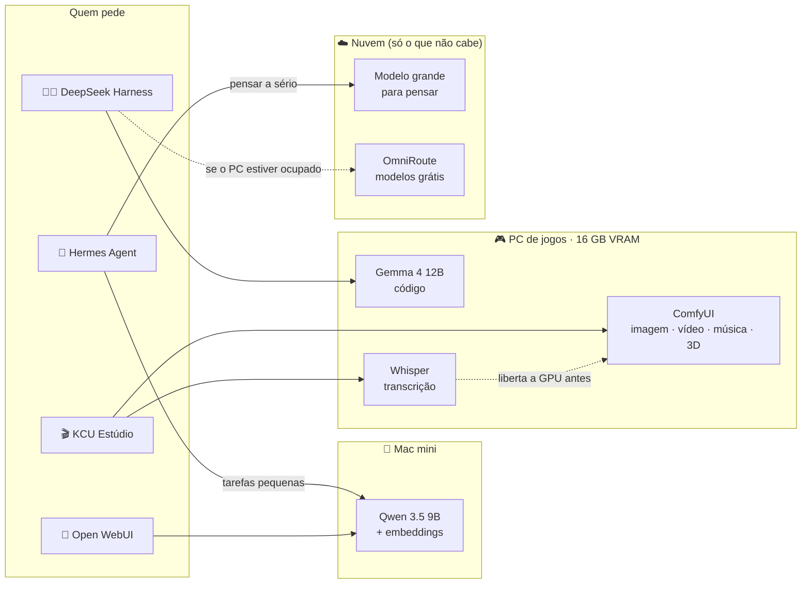

# IA local

Tudo o que dá para correr em casa, corre em casa: os dados não saem e não há conta para pagar ao fim do mês. A nuvem fica para o que não cabe aqui.

## Texto: Mac mini (sempre ligado)

| O quê | Definição | Porquê |
|---|---|---|
| [Ollama](https://ollama.com) | servidor de modelos | simples, e a API é compatível com quase tudo |
| **Qwen 3.5 9B** | modelo principal, ~17 tokens/s no M4 | o melhor equilíbrio qualidade/velocidade em 16 GB |
| Modelo "kcu" | o mesmo 9B com instruções para responder sempre em português de Portugal | sem isto, vem português do Brasil |
| **Qwen3 Embedding 4B** | embeddings | pesquisa nas notas e na memória dos agentes |
| Contexto | 32k | dá para documentos e conversas longas sem rebentar a RAM |
| Keep-alive | 30 min | o modelo não está sempre a carregar e a descarregar |
| [Open WebUI](https://openwebui.com) | chat no browser | o "ChatGPT de casa", em Docker com memória limitada |

**Dica:** o "pensamento" (thinking) destes modelos deixa tudo muito mais lento. Desliga-o nas tarefas simples.

## Código: PC de jogos

| O quê | Definição |
|---|---|
| **Gemma 4 12B (QAT)** | 7,2 GB, cabe todo na GPU, ~60 tokens/s |
| Contexto | 128k, a ocupar ~8 GB de VRAM |
| Usado por | agente de programação (DeepSeek Harness) |

**Lição:** um modelo de 27B que não cabe na VRAM é mais lento do que um de 12B que cabe. Primeiro tem de caber na GPU.

## Imagem, vídeo e áudio: PC de jogos (16 GB VRAM) com [ComfyUI](https://github.com/comfyanonymous/ComfyUI)

| Tarefa | Modelo | Nota |
|---|---|---|
| Imagem | Z-Image Turbo (int8) | 3–4 s por imagem |
| Editar imagem | Qwen-Image-Edit 2511 + LoRA de 4 passos | mudar uma imagem mantendo a personagem |
| Vídeo | Wan 2.2 I2V 14B (fp8) + lightx2v | imagem → vídeo, cabe em 16 GB |
| Música | ACE-Step | |
| 3D | TRELLIS.2 | imagem → modelo 3D |
| Aumentar e suavizar | SeedVR2, RealESRGAN, FILM | vertical 1080×1920 a 60 fps |
| Transcrição | Whisper large-v3-turbo (faster-whisper) | tempos por palavra, para legendas |

**Truque que faz diferença:** o servidor de transcrição liberta a GPU sozinho (manda o ComfyUI e o Ollama descarregar os modelos) antes de trabalhar. Assim, 16 GB chegam para tudo, só que não ao mesmo tempo.

## Ferramentas de vídeo: PC de trabalho (8 GB VRAM)

WhisperX, MediaPipe, SAM2, Depth Anything V2, BEN2, CLAP e PySceneDetect, num servidor local. Cortar silêncios, seguir caras, tirar fundos e achar cenas.

**Atenção às licenças:** alguns modelos (por exemplo o Demucs e certas versões do Depth Anything) não deixam uso comercial. Confirma antes de usar num produto pago.

## Agentes

| Agente | O que faz | Cérebro |
|---|---|---|
| [Hermes Agent](https://github.com/NousResearch/hermes-agent) | o "assistente da casa": crons, alertas, Discord | modelo grande na nuvem para pensar; tarefas pequenas no Qwen do Mac |
| DeepSeek Harness | agente de programação no browser | Gemma 4 do PC de jogos, ou modelos grátis pelo OmniRoute |
| OmniRoute | uma porta só para muitos modelos grátis, com troca automática quando um falha | |
| Claude Code | o resto: montar, corrigir e organizar tudo isto | |
