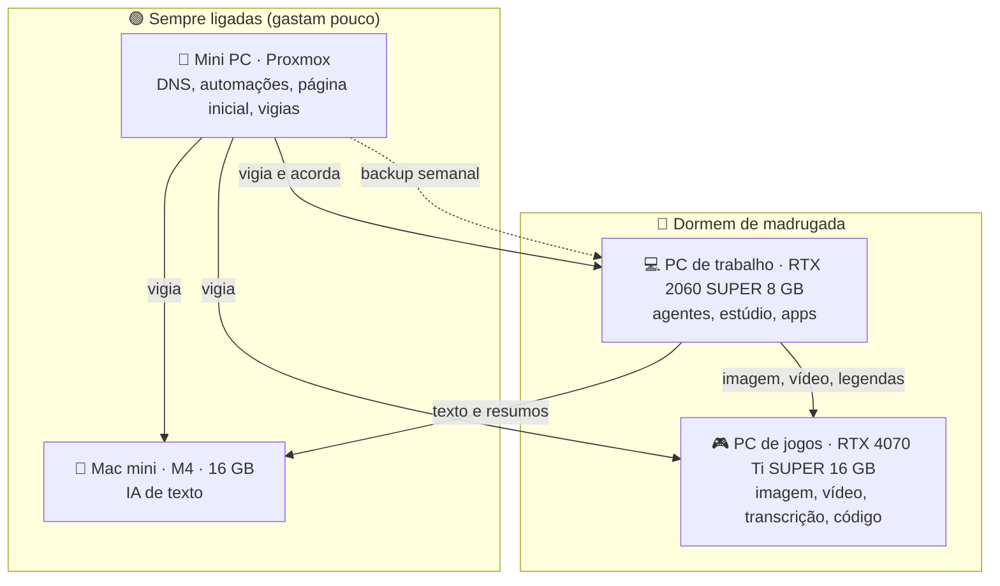

# Máquinas

São quatro máquinas, cada uma com um papel. A regra é simples: **o trabalho vai para a máquina que o faz melhor e gasta menos.**

| Máquina | Papel | CPU | GPU | RAM | Disco | Sistema |
|---|---|---|---|---|---|---|
| 🎮 PC de jogos | IA pesada (imagem, vídeo, transcrição) e jogos | Ryzen 7 7800X3D (8 núcleos) | RTX 4070 Ti SUPER, 16 GB | 32 GB DDR5 | NVMe 1 TB | Windows 11 Pro |
| 💻 PC de trabalho | Agentes, estúdio de vídeo, apps de secretária | Ryzen 5 3600X | RTX 2060 SUPER, 8 GB | 32 GB DDR4 | NVMe 500 GB + HDD 2 TB | Windows 11 Pro |
| 🍎 Mac mini | IA de texto 24/7 | Apple M4 | integrada | 16 GB | SSD 256 GB | macOS |
| 🧱 Mini PC | Servidor Proxmox (homelab) | Ryzen 5 7430U (12 threads) | integrada | 32 GB | SSD 480 GB | Proxmox VE 9 |

## Porquê assim

- **PC de jogos = GPU grande.** Os 16 GB de VRAM aguentam modelos de imagem e vídeo que não cabem noutro lado. Quando não está a gerar nada, joga-se nele.
- **Mac mini = texto sempre ligado.** O M4 corre um modelo de 9B a uma velocidade decente e gasta muito pouco. Os agentes pedem-lhe texto a qualquer hora sem acordar os PCs grandes.
- **PC de trabalho = onde se trabalha.** Agentes de programação, o estúdio de vídeo e as apps que abrimos no telemóvel com o [KCU Window](https://github.com/KCUServices/kcu-window).
- **Mini PC = o que nunca pode desligar.** DNS, automações, página inicial e vigias. Gasta pouco e está ligado 24/7.

## Lições que aprendemos

- **Windows num HDD não dá.** Arranques lentos e serviços a morrer por esperarem pelo disco. O sistema vai sempre para SSD.
- **Separa IA de jogos em discos ou partições.** Os modelos ocupam centenas de GB e enchem o disco sem dares por isso.
- **Um só SSD no servidor é um risco.** Faz backups para outra máquina desde o primeiro dia (ver [Automáticos](automaticos.md)).
