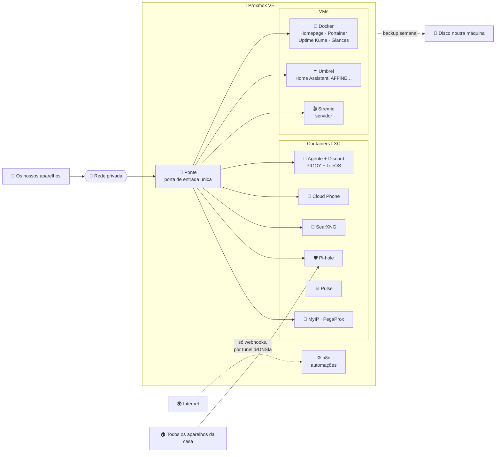

# Proxmox

O servidor de casa é um mini PC com **Proxmox VE**. Cada serviço vive no seu container (LXC) ou VM: se um parte, os outros continuam, e cada um tem backup à parte.

| Tipo | Nome | Para que serve |
|---|---|---|
| LXC | **pihole** | DNS da casa toda e bloqueio de anúncios. |
| LXC | **agente** | Agente de IA "sempre ligado" ([Hermes Agent](https://github.com/NousResearch/hermes-agent)), bot do Discord, PIGGY e LifeOS. |
| LXC | **cloud-phone** | Um telemóvel Android que se usa pelo browser (scrcpy por WebRTC). |
| LXC | **myip** | Ferramentas de IP e de rede. |
| LXC | **pegaprox** | Painel extra para gerir o Proxmox. |
| LXC | **searxng** | Motor de pesquisa privado, sem rastreio. |
| LXC | **pulse** | Métricas do canal e da loja, e relatório todas as noites no Discord. |
| LXC | **n8n + ponte** | Automações (n8n) e a "porta de entrada": um nginx que dá acesso aos serviços de casa pela rede privada. |
| VM | **docker** | Página inicial ([homepage](https://gethomepage.dev)), Portainer, Uptime Kuma e Glances. |
| VM | **umbrel** | [Umbrel](https://umbrel.com) com Home Assistant, AFFiNE, AudioBookShelf, BookLore, SwingMusic, [MeTube](https://github.com/alexta69/metube) (só para os nossos vídeos ou conteúdo com licença livre) e [RomM](https://github.com/rommapp/romm) (só cópias de jogos que temos)… |
| VM | **streamio** | Servidor do [Stremio](https://www.stremio.com) para ver na TV e no telemóvel. Só com addons oficiais e legais. |

## Decisões

- **LXC sempre que dá, VM só quando é preciso.** Um LXC gasta muito menos. A VM fica para o que precisa do seu próprio kernel (Docker "a sério", Umbrel).
- **A ponte.** Em vez de pôr cada serviço na rede privada, um único container faz de porta de entrada e encaminha para os outros. Para juntar um serviço novo basta uma linha de configuração. O modelo está em [homelab/ponte-tailscale](../homelab/ponte-tailscale).
- **Webhooks à parte.** O n8n recebe webhooks de fora por um túnel de saída que só deixa passar esses caminhos. O resto do servidor nunca fica visível.
- **Backups para outra máquina.** Todas as semanas, para um disco do PC de trabalho. Um backup no mesmo disco não é backup. Como montar está em [homelab/backup-proxmox](../homelab/backup-proxmox).

## Uso legal

Algumas destas apps servem para coisas que podem ser legais ou não, conforme o que fazes com elas. A nossa regra:

| App | Como a usamos |
|---|---|
| **Stremio** | Só com addons oficiais e legais (serviços que pagamos ou conteúdo livre). Nada de addons de pirataria. |
| **RomM** | Só para guardar cópias de jogos que comprámos e temos. |
| **MeTube** | Só para descarregar os nossos próprios vídeos ou conteúdo com licença livre (Creative Commons, domínio público). |

Usa-as da mesma forma. A responsabilidade pelo que descarregas e vês é tua, e as leis de direitos de autor aplicam-se em casa também.

## Ferramentas no próprio servidor

- [ProxMenux](https://github.com/MacRimi/ProxMenux): menus para tarefas comuns do Proxmox.
- Atualizações de segurança automáticas.
- Proteção do servidor: o passo a passo está no [Playbook de Proteção](https://whop.com/kcu-services/kcu-playbook-protecao/).
