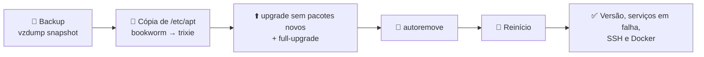

# Atualizar containers para o Debian 13 ⬆️

Um script que passa um container (LXC) do Proxmox de **Debian 12 (bookworm) para Debian 13 (trixie)**, com backup antes e verificação depois. Um container de cada vez, sem pressa.



| Ficheiro | O que é |
|---|---|
| [atualizar-debian13.sh](atualizar-debian13.sh) | Faz tudo, por esta ordem, e para no primeiro erro. Registo em `/root/atualizar-debian13-<id>.log`. |

## Porquê assim

| Escolha | Porquê |
|---|---|
| **Backup antes, sempre** | Se a atualização correr mal, voltas ao estado de antes em minutos. Em modo snapshot, o container não para durante o backup. |
| **Também os repositórios externos** | Docker, Tailscale e outros têm os seus ficheiros em `sources.list.d/`. Se ficassem em bookworm, misturavas pacotes de duas versões. |
| **Primeiro `upgrade --without-new-pkgs`, depois `full-upgrade`** | É a ordem que o Debian recomenda: atualiza o que já existe e só depois resolve as mudanças maiores. |
| **`--force-confold`** | Um ficheiro de configuração que tu alteraste fica como está, sem perguntas a meio. |
| **`systemd-run --collect`** | A atualização corre no Proxmox, fora da tua sessão. Se o SSH cair (ou fechares o portátil), continua até ao fim. O `--collect` deixa voltar a correr com o mesmo nome depois de um erro. |
| **Para no primeiro erro** | Se um repositório ainda não tiver versão para o trixie, o `apt-get update` falha e nada é instalado. Corriges e corres outra vez. |

## Antes de começar

- **Proxmox VE 8.4 ou mais recente.** Versões antigas recusam arrancar um container com Debian 13 e ele ficava parado depois do reinício. O script verifica e não avança.
- **Nesting ligado** nos containers sem privilégios (**CT > Options > Features > Nesting**). O systemd do Debian 13 precisa dele, senão vários serviços falham ao arrancar. O script avisa se faltar.

## Passos

1. Copia o script para o Proxmox:
   ```bash
   cp atualizar-debian13.sh /root/ && chmod 700 /root/atualizar-debian13.sh
   ```
2. Confirma que o storage do backup tem espaço (por defeito, `local`; podes dar outro como 2.º argumento).
3. Corre, com o container ligado:
   ```bash
   systemd-run --collect --unit=debian13-200 /root/atualizar-debian13.sh 200
   journalctl -fu debian13-200
   ```
4. No fim aparecem a versão, os serviços em falha, as opções do SSH e os containers Docker. Vê a secção seguinte antes de passar ao próximo.

## O que verificar depois

- **O `sshd_config` pode ser substituído.** O `--force-confold` só guarda os ficheiros que alteraste. Se o teu `sshd_config` nunca foi mexido (as definições estão num ficheiro em `sshd_config.d/`, por exemplo), entra o novo do Debian 13. Confirma `PasswordAuthentication` e `PermitRootLogin` (o script mostra-os em `ssh:`) e entra por SSH **antes** de fechar a consola.
- **O Docker reinicia a meio da atualização.** Os containers Docker param e voltam a arrancar quando o pacote do Docker é atualizado. Os que não têm *restart policy* ficam parados.
- **Contentores com Docker devem ter restart policy.** Põe `restart: unless-stopped` no `docker-compose.yml` (ou `docker update --restart unless-stopped <nome>`) **antes** de atualizar. O script lista no fim o estado de cada um.
- **O `autoremove` pode tirar pacotes Python.** Bibliotecas que tinham entrado como dependência e já não são precisas no Debian 13 saem. Se um script teu as usava, deixa de funcionar. Vê no registo o que foi removido e volta a instalar com `apt install` (assim ficam marcadas como instaladas por ti e o `autoremove` não as volta a tirar).
- **Serviços em falha.** Cada linha `FALHOU:` é um serviço a ver com `systemctl status <serviço>` e `journalctl -u <serviço>`.

## Desfazer

Os ficheiros de antes do `/etc/apt` ficam em `/root/apt.antes-debian13`, dentro do container. Para voltar **ao container inteiro** como estava, restaura o backup feito no início:

```bash
pct stop 200
pct restore 200 local:backup/vzdump-lxc-200-<data>.tar.zst --force --storage local-lvm
pct start 200
```

O nome exato do backup está em **Datacenter > Storage > (o storage) > Backups**, com a nota "antes do Debian 13". O `--force` substitui o container atual: tudo o que mudou depois do backup perde-se.

## Cuidados

- **Um container de cada vez.** Atualiza, verifica, usa-o um dia, e só depois o seguinte.
- Começa por um container pequeno e pouco importante, para conheceres o processo.
- Não serve para VMs nem para o próprio Proxmox: esses têm os seus próprios guias de atualização.
- Proteger o servidor em si é outro assunto: está no [Playbook de Proteção](https://whop.com/kcu-services/kcu-playbook-protecao/).
