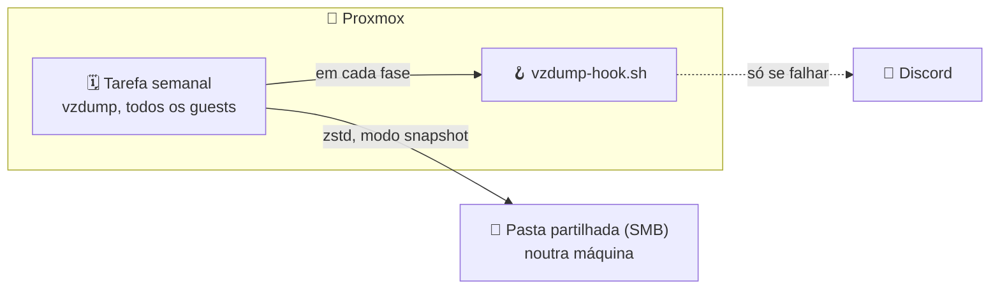

# Backup do Proxmox 💾

Todas as semanas, o Proxmox faz backup de **todos** os containers e VMs para uma pasta partilhada **noutra máquina**. Guarda os 2 últimos e, se algum falhar, avisa no Discord.



| Ficheiro | O que é |
|---|---|
| [jobs.cfg.exemplo](jobs.cfg.exemplo) | Como fica a tarefa de backup no Proxmox. |
| [vzdump-hook.sh](vzdump-hook.sh) | Script que avisa no Discord quando um backup falha. Lê o webhook de um ficheiro ou variável, nunca do código. |

## Porquê assim

| Escolha | Porquê |
|---|---|
| **Outra máquina** | Um backup no mesmo disco morre com o disco. Noutra máquina sobrevive a uma avaria do servidor. |
| **Todos os guests** (`all 1`) | Um container novo entra no backup sozinho. Não há lista para te esqueceres de atualizar. |
| **Modo snapshot** | Os serviços não param durante o backup. |
| **zstd** | Comprime bem e é rápido, sem pesar no processador. |
| **Guardar os 2 últimos** (`keep-last=2`) | Se o último backup tiver um problema, ainda há o da semana anterior, e o disco não enche. |
| **Domingo à hora de almoço** | O PC que recebe os backups dorme de madrugada. Escolhe uma hora em que a máquina de destino está ligada. |
| **Aviso só quando falha** | Uma mensagem por semana a dizer "correu bem" acaba ignorada. Só falamos quando é preciso. |

## 1. Juntar a pasta partilhada como storage

Na máquina de destino, cria uma pasta partilhada (SMB) e um utilizador próprio só com acesso a essa pasta.

No Proxmox: **Datacenter > Storage > Add > SMB/CIFS**

| Campo | O que pôr |
|---|---|
| ID | Um nome à tua escolha, por exemplo `backup-noutra-maquina` |
| Server | O IP da máquina de destino (fixo, com reserva DHCP no router) |
| Username / Password | O utilizador criado só para isto |
| Share | Escolhe a pasta na lista |
| Content | Só `VZDump backup file` |

A palavra-passe fica guardada pelo Proxmox, fora do `storage.cfg`.

## 2. Criar a tarefa semanal

**Datacenter > Backup > Add**

- **Storage:** o que criaste no passo 1
- **Schedule:** `sun 12:00` (ou outra hora em que o destino está ligado)
- **Selection mode:** `All`
- **Mode:** `Snapshot` · **Compression:** `ZSTD`
- **Retention:** `Keep Last = 2`
- **Notes:** `{{guestname}}`, para saberes de que guest é cada ficheiro

O resultado fica como no [jobs.cfg.exemplo](jobs.cfg.exemplo).

## 3. Aviso no Discord quando falha

1. No Discord: definições do canal > Integrações > Webhooks > Novo webhook > Copiar URL.
2. No Proxmox, guarda o URL num ficheiro só legível pelo root:
   ```bash
   install -m 600 /dev/null /root/.discord-webhook
   nano /root/.discord-webhook   # cola o URL e grava
   ```
3. Instala o hook:
   ```bash
   cp vzdump-hook.sh /root/vzdump-hook.sh
   chmod 700 /root/vzdump-hook.sh
   ```
4. Liga-o à tarefa: em `/etc/pve/jobs.cfg`, na tarefa de backup, acrescenta a linha `script /root/vzdump-hook.sh` (o painel não tem este campo).
5. Testa o aviso sem esperar por uma falha:
   ```bash
   /root/vzdump-hook.sh job-abort
   ```
   Deve chegar uma mensagem ao canal.

## 4. Testar um restauro (o passo que toda a gente salta)

Um backup que nunca foi restaurado é só uma esperança. Faz isto de vez em quando:

1. **Datacenter > Storage > (o teu storage) > Backups**, escolhe o backup de um container pequeno.
2. **Restore**, com um **ID novo** (por exemplo 900), para não tocar no original.
3. Antes de o ligar, em **Network**, desliga a placa de rede (`disconnect`) ou muda o IP, para não ficar com dois iguais na rede.
4. Arranca, entra na consola e confirma que os dados estão lá.
5. Apaga o guest de teste.

Pela linha de comandos é o mesmo:

```bash
# container (LXC)
pct restore 900 <storage>:backup/<ficheiro>.tar.zst --storage local-lvm
# VM
qmrestore <storage>:backup/<ficheiro>.vma.zst 900 --storage local-lvm
```

## Cuidados

- Se a máquina de destino estiver desligada à hora do backup, a tarefa falha e o hook avisa. É exatamente para isso que ele existe.
- Os backups têm tudo o que está nos guests, incluindo palavras-passe e chaves. Trata a pasta de destino como dados sensíveis.
- Proteger o servidor em si é outro assunto: está no [Playbook de Proteção](https://whop.com/kcu-services/kcu-playbook-protecao/).
