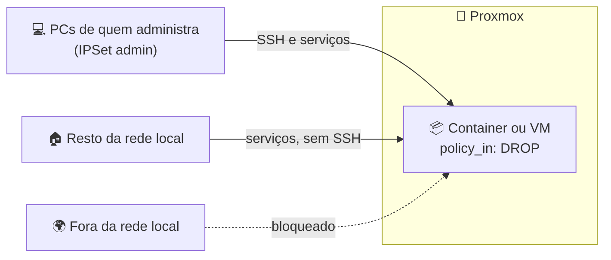

# Firewall nos guests do Proxmox 🧱🔒

Liga a firewall do Proxmox num container (LXC) ou numa VM com uma regra simples: **o SSH só entra a partir das máquinas de quem administra**. O resto da rede local continua a chegar aos serviços como antes, e o que vem de fora da rede local fica bloqueado. O mesmo script serve para containers e VMs: descobre sozinho qual é.



| Ficheiro | O que é |
|---|---|
| [firewall-guest.sh](firewall-guest.sh) | Escreve o `/etc/pve/firewall/<id>.fw`, liga `firewall=1` nas placas de rede do guest e guarda o `.fw` anterior. Tem `--ensaio` e `--desfazer`. |
| [firewall-guests.conf.exemplo](firewall-guests.conf.exemplo) | Os teus valores: IPs de quem administra, a rede local e (opcional) o prefixo IPv6. |
| [testar-portas.sh](testar-portas.sh) | Testa portas de um guest a partir de outro container que não é admin. |

## Porquê assim

| Escolha | Porquê |
|---|---|
| **SSH só para quem administra** | O SSH dá a consola inteira do guest. Não há razão para a televisão ou o telemóvel de uma visita lá chegarem. Se um aparelho da casa for comprometido, não consegue tentar palavras-passe no SSH. |
| **O resto da rede local como antes** | Ligar a firewall não deve partir nada. Este modelo fecha o que é só de administração (o SSH); se quiseres ir mais longe, troca a linha da rede local por regras só para as portas de cada serviço. |
| **`policy_in: DROP`** | O que não está nas regras não entra. Uma porta nova que abras por engano no guest não fica logo visível. |
| **`dhcp: 1` e `ndp: 1`** | Sem isto, o guest pode ficar sem IP (DHCP) ou sem IPv6 (descoberta de vizinhos). |
| **IPSet `admin`** | A lista de quem administra fica num só sítio, com nome. Juntar um PC é uma linha. |
| **Tailscale opcional (UDP 41641)** | Se o guest corre o Tailscale, esta porta deixa-o fazer ligações diretas em vez de passar por um relay. |
| **Cópia do `.fw` anterior** | Voltar atrás é copiar um ficheiro. |

## Antes de começar

- A firewall do Proxmox tem dois níveis: o **Datacenter** e cada guest. As regras de um guest só se aplicam com a do Datacenter ligada (**Datacenter > Firewall > Options > Firewall: Yes**). Ao ligá-la, confirma antes que tens regras que deixam entrar o painel (8006) e o SSH do próprio Proxmox a partir das tuas máquinas, senão podes ficar de fora. O script avisa se a do Datacenter estiver desligada.
- Dá IP fixo às máquinas de quem administra (reserva DHCP no router). Se o IP mudar, o SSH deixa de entrar.
- Tem sempre a consola do Proxmox à mão (**guest > Console**, ou `pct enter <id>` para containers). Não passa pela firewall do guest, por isso é a tua porta das traseiras se algo correr mal.

## Passos

1. Copia esta pasta para o Proxmox, por exemplo para `/root/firewall-guests`, e prepara os teus valores:
   ```bash
   cd /root/firewall-guests
   cp firewall-guests.conf.exemplo firewall-guests.conf
   nano firewall-guests.conf   # ADMINS, REDE4 e, se usares IPv6, REDE6
   chmod 700 firewall-guest.sh testar-portas.sh
   ```
2. Vê o que ia ficar, sem mexer em nada:
   ```bash
   ./firewall-guest.sh 200 --ensaio
   ```
3. Aplica num guest (acrescenta `--tailscale` se ele corre o Tailscale):
   ```bash
   ./firewall-guest.sh 200
   ```
4. Testa (secção seguinte) e só depois passa ao próximo guest.

## Testar

Logo a seguir a aplicar, **sem fechar a sessão onde estás**:

1. A partir de um PC admin: `ssh root@<ip-do-guest>` tem de entrar.
2. A partir de algo que **não** é admin, por exemplo outro container:
   ```bash
   ./testar-portas.sh 201 192.168.1.50 22 80 443
   # esperado: 192.168.1.50: 22=fechada 80=aberta 443=aberta
   ```
   Põe as portas dos serviços desse guest. O 22 tem de dar `fechada` e os serviços como estavam antes.
3. Abre os serviços do guest no browser, como fazes no dia a dia.

## Desfazer

```bash
./firewall-guest.sh 200 --desfazer
```

Põe `enable: 0` no `.fw` do guest (as regras ficam lá, desligadas) e guarda uma cópia antes. Para voltar ao ficheiro exato de antes, copia a cópia de volta:

```bash
cp /root/firewall-200.fw.antes-<data> /etc/pve/firewall/200.fw
```

Também dá pelo painel: **guest > Firewall > Options > Firewall: No**.

## Cuidados

- **Um guest de cada vez.** Aplica, testa e só depois passa ao seguinte. Se algo partir, sabes logo qual foi e o que mudou.
- Se o guest já tinha um `.fw` com regras tuas, o script substitui-o (o anterior fica na cópia em `/root/firewall-<id>.fw.antes-<data>`). Usa `--ensaio` e junta à mão o que quiseres manter.
- O SSH **dentro do Tailscale** não passa por esta firewall (vem dentro do túnel). Para isso usa as ACLs do Tailscale.
- O IPSet `admin` deve incluir o próprio Proxmox, para scripts que entram por SSH a partir dele.
- O `testar-portas.sh` dá `fechada` tanto para "bloqueada" como para "nada a escutar". Testa antes de aplicar para saberes o que estava aberto.
- Proteger o próprio Proxmox (painel, SSH, atualizações) é outro assunto: o passo a passo está no [Playbook de Proteção](https://whop.com/kcu-services/kcu-playbook-protecao/).
