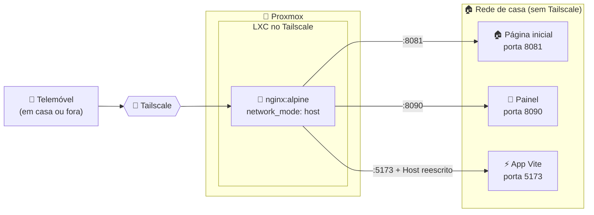

# Ponte Tailscale 🚪

Um único container com **nginx** que faz de porta de entrada para os serviços de casa. Do telemóvel, pelo Tailscale, chegas a tudo com **um só nome de máquina**: muda só a porta.



| Ficheiro | O que é |
|---|---|
| [docker-compose.yml](docker-compose.yml) | O container: `nginx:alpine` em `network_mode: host`. |
| [nginx.conf.exemplo](nginx.conf.exemplo) | Exemplo com 3 serviços, incluindo uma app Vite que precisa do Host reescrito. |

## Porquê assim

- **Ponte em vez de subnet router.** O Tailscale consegue anunciar a rede de casa inteira (subnet router), mas isso dá a qualquer aparelho da tailnet acesso a *tudo* o que está na rede: router, impressora, câmaras. Com a ponte, só passa o que tu escreves no `nginx.conf`, porta a porta.
- **Um nome para tudo.** Os serviços não precisam de ter o Tailscale instalado (muitos nem conseguem, como VMs fechadas ou aparelhos). Só o LXC da ponte está na tailnet.
- **`network_mode: host`.** O nginx escuta diretamente nas portas do LXC. Não há mapeamento de portas no Docker para manter: juntar um serviço é só mexer no `nginx.conf`.
- **`stream` primeiro.** O bloco `stream` passa o TCP tal e qual, por isso funciona com HTTP, HTTPS e WebSockets sem configurar nada. O bloco `http` fica só para os casos que precisam de mexer nos cabeçalhos.
- **A mesma porta dos dois lados.** A porta na ponte é igual à do serviço. Assim não tens de decorar uma tabela de conversões.

## Montar

1. Cria um LXC pequeno (Debian, 1 CPU, 512 MB chegam) e instala o Docker e o Tailscale nele.
2. Copia esta pasta para o LXC, por exemplo para `/opt/ponte-tailscale`.
3. Copia o exemplo e põe os teus endereços:
   ```bash
   cp nginx.conf.exemplo nginx.conf
   ```
4. Arranca:
   ```bash
   docker compose up -d
   ```
5. Do telemóvel, com o Tailscale ligado: `http://<nome-do-lxc-na-tailnet>:8081`.

## Juntar um serviço novo

1. Acrescenta uma linha ao bloco `stream`:
   ```nginx
   server { listen 9000; proxy_pass 192.0.2.40:9000; }   # o teu serviço
   ```
2. Testa e recarrega, sem parar os outros serviços:
   ```bash
   docker exec ponte-tailscale nginx -t
   docker exec ponte-tailscale nginx -s reload
   ```

Se a app responder "host not allowed" ou "invalid host header" (Vite, alguns painéis em Node), em vez de uma linha no `stream` usa um `server` no bloco `http`, como o exemplo da porta 5173.

## Cuidados

- Dá ao serviço um IP fixo (reserva DHCP no router). Se o IP mudar, a ponte aponta para o sítio errado.
- A ponte não acrescenta login. Cada serviço continua a precisar da sua própria palavra-passe.
- Para proteger o servidor em si (firewall, acessos, atualizações), o passo a passo está no [Playbook de Proteção](https://whop.com/kcu-services/kcu-playbook-protecao/).
