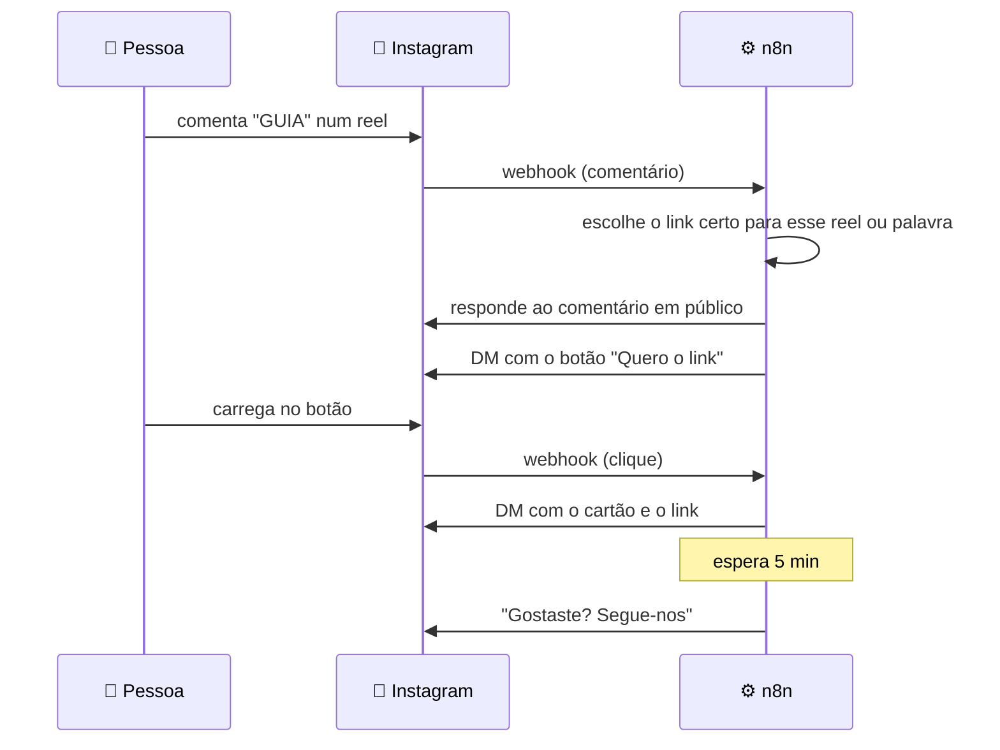
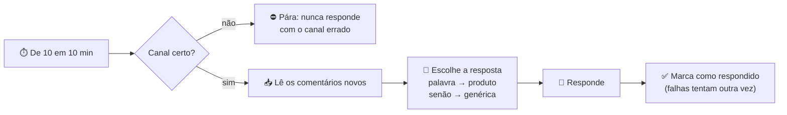

# Fluxos do n8n

Dois fluxos que respondem sozinhos a quem comenta nos nossos vídeos. Estão prontos a importar no [n8n](https://n8n.io); só tens de ligar as tuas contas e trocar os marcadores.

## 1. Instagram: comentário → resposta pública + DM com o link

É o famoso "comenta GUIA e envio-te o link", feito em casa, sem pagar um ManyChat.

**O que tem de especial:**
- **Escolhe o link sozinho:** pelo ID do reel, pela palavra comentada ou pela legenda do reel. Se não encontrar nada, manda o índice de todos os links.
- **O link só vai depois do clique no botão.** É o que a Meta permite fora da janela de 24 h, e ainda conta como interação.
- **Variação humana:** as frases mudam e nunca repete a última, com um pequeno atraso antes de responder.
- **Registar publicação:** um segundo webhook deixa o teu agente de publicação dizer "este reel leva este link", sem mexeres no fluxo.

**Precisas de:**
- uma app no [Meta for Developers](https://developers.facebook.com) com o produto Instagram, as permissões de comentários e mensagens e o webhook de `comments` e `messages` a apontar para `https://<o-teu-n8n>/webhook/instagram-comentarios`;
- uma credencial **Header Auth** no n8n com `Authorization: Bearer <o teu token do Instagram>`;
- um n8n acessível de fora: um túnel de saída (por exemplo Cloudflare Tunnel) que só expõe `/webhook/`.

## 2. YouTube: respostas automáticas a comentários

O YouTube não tem DM, por isso a resposta é pública e aponta para a descrição do vídeo.

**Precisas de:** uma conta no [Composio](https://composio.dev) com o YouTube ligado e uma credencial **Header Auth** com a tua chave do Composio (`x-api-key`).

## Importar

1. No n8n: **Workflows → Import from file** e escolhe o `.json`.
2. Em cada nó a vermelho, escolhe a tua credencial.
3. Troca os marcadores:

| Marcador | Onde | Pelo quê |
|---|---|---|
| `TROCA_PELO_TEU_VERIFY_TOKEN` | Instagram → "Responder challenge" | O "verify token" que puseste na app da Meta. |
| `TROCA_PELO_TEU_SEGREDO` | Instagram → "Preparar registo" | Uma senha longa, que só o teu agente de publicação sabe. |
| `ID_DE_UM_REEL`, tabelas `POR_REEL` / `POR_PRODUTO` | Instagram → "Escolher link" | Os teus reels, palavras e links. |
| `https://o-teu-site.exemplo/go/` | os dois | A tua página de links. |
| `ID_DA_SEGUNDA_CONTA`, `segunda_conta` | Instagram | Só se tiveres duas contas; senão podes apagar esses ramos. |
| `O_ID_DO_TEU_CANAL`, `o-teu-user-id` | YouTube | O ID do teu canal (começa por `UC`) e o teu utilizador no Composio. |

4. Ativa o fluxo e faz um teste: comenta a partir de outra conta.

## Cuidados

- **Os segredos nunca ficam no fluxo que partilhas.** Antes de exportar o teu, procura tokens e senhas nos nós Code e nas respostas.
- **Respeita as regras da Meta e do YouTube:** responde só a quem comentou e não mandes mensagens a quem não te contactou.
