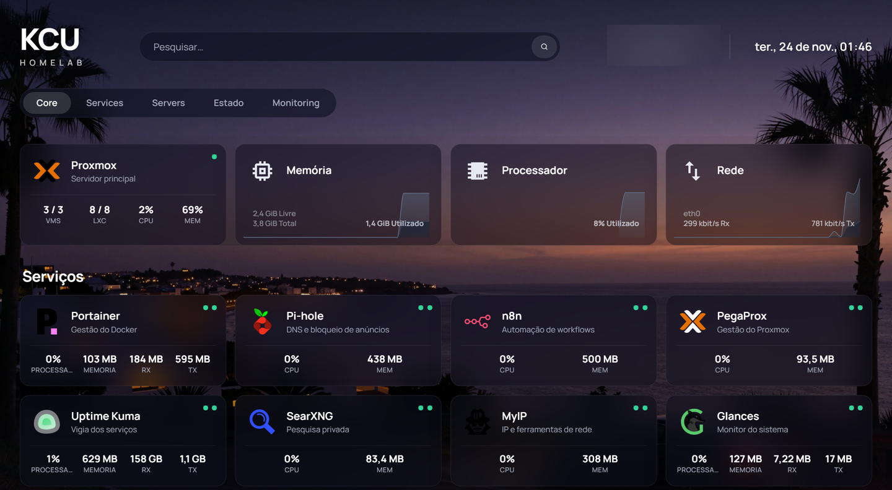

# Tema da homepage: "Vidro ao anoitecer"

O tema da nossa página inicial ([gethomepage](https://gethomepage.dev)): uma foto de fundo e cartões de vidro escuro por cima, separadores em pílula e um logótipo "KCU / HOMELAB".



## Como usar

1. Copia o [`custom.css`](custom.css) para a pasta de configuração do teu gethomepage (onde estão o `settings.yaml` e o `services.yaml`).
2. No `settings.yaml`, escolhe a tua foto de fundo e liga o tema escuro:

   ```yaml
   title: O MEU HOMELAB
   theme: dark
   color: slate
   background:
     image: /images/fundo.jpg   # põe a foto na pasta public/images do gethomepage
     brightness: 75
   cardBlur: md
   headerStyle: clean
   ```

3. Recarrega a página. Se não mudar nada, força a releitura da configuração: `curl http://<a-tua-homepage>:3000/api/revalidate`

## Dicas

- **A foto faz o tema.** Escolhe uma foto escura (noite ou pôr do sol), com o céu em cima: o texto lê-se melhor.
- **Cuidado com o que a foto mostra.** Se publicares prints da tua página, uma foto da tua rua ou um widget do tempo com a tua cidade dizem onde vives.
- Para mudar o texto do logótipo, procura `HOMELAB` no `custom.css`.

## Licença

[PolyForm Noncommercial 1.0.0](../LICENSE): uso pessoal à vontade.
